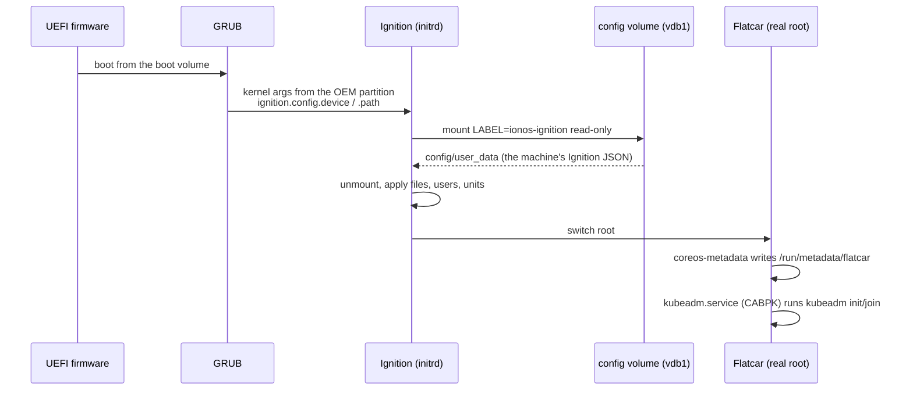
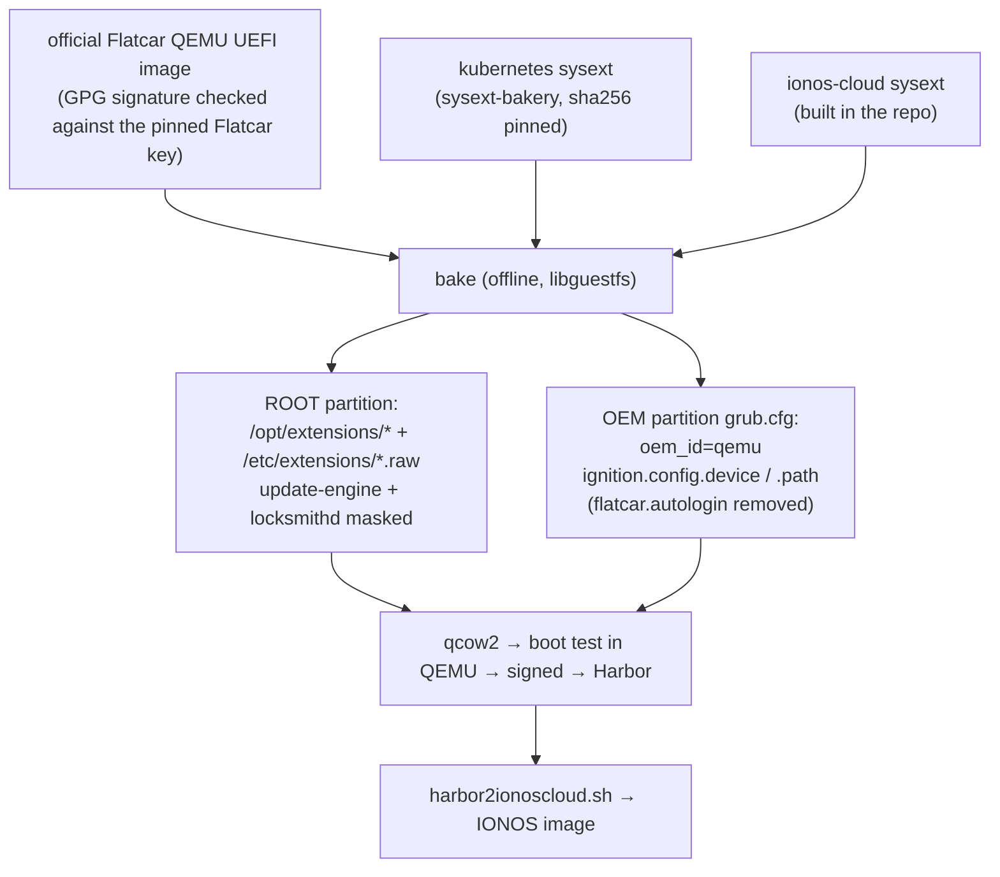

# Flatcar support on IONOS Cloud (design)

Status: proposal · Tracking issue: [#268](https://github.com/ionos-cloud/cluster-api-provider-ionoscloud/issues/268)

This document explains how we run [Flatcar Container Linux](https://www.flatcar.org/) nodes on IONOS
Cloud with CAPIC: how the image is built, how the machine's Ignition config reaches the VM, what we
tested, and what CAPIC has to change. Everything below was tried on real IONOS servers (`de/fra/1`,
October 2026) unless it says otherwise.

## The problem in one paragraph

Flatcar is configured on first boot by [Ignition](https://coreos.github.io/ignition/). Ignition needs
to find its config somewhere: a metadata service, a config drive, a kernel argument. IONOS Cloud has
no metadata service and no config drive. What it does have is a volume property called `userData`,
which today only works for cloud-init images. So the question was: how do we get the `userData` of a
volume into Ignition, without patching Flatcar?

## The short answer

1. IONOS already writes `userData` into a volume before the VM starts, if it finds a marker file on a
   partition of that volume.
2. Ignition (since 2.27) can read its config from a labelled partition, if two kernel arguments tell it
   where.
3. So we give every Flatcar machine a **second, tiny volume** that carries the marker, and we bake the
   two kernel arguments into the Flatcar image. IONOS writes the config onto the small volume, Ignition
   reads it from there. No fork of Flatcar or Ignition is needed.

```mermaid
flowchart LR
    CAPI["CAPI / CABPK<br/>bootstrap secret<br/>(format: ignition)"] -->|userData| CAPIC
    CAPIC -->|"create server<br/>vol 1: Flatcar image<br/>vol 2: config volume + userData"| API[IONOS Cloud API]
    API --> INJ["IONOS image handler<br/>(runs before first power-on)"]
    INJ -->|"finds USER_DATA_INJECTION_FLATCAR,<br/>writes config/user_data"| VOL2[("config volume<br/>label: ionos-ignition")]
    VOL2 -->|"ignition.config.device=ionos-ignition<br/>ignition.config.path=config/user_data"| IGN[Ignition in the initrd]
    IGN --> NODE[Flatcar node joins the cluster]
```



## How IONOS injects `userData`

When a volume is created with `userData`, the IONOS image handler runs
on the storage host **before** the VM is powered on.
It mounts each partition of the volume and looks around:

| What it finds on a partition | What it writes |
|---|---|
| `/etc/cloud/` (a cloud-init image) | `/var/lib/cloud/seed/nocloud/{user-data,meta-data}` |
| a file named `USER_DATA_INJECTION_FLATCAR` at the partition root | `<partition>/config/user_data` |
| neither | nothing |

Facts we checked:

- It looks at ext4/xfs-style data partitions only. Flatcar's own OEM (btrfs) and EFI (vfat)
  partitions are not used, and the stock Flatcar ROOT has no marker, so a plain Flatcar volume gets
  nothing.
- The file name is `config/user_data` (underscore). It is written byte for byte as given in the API.
- It works on **any** volume of the server that has `userData`, not only the boot volume.
- The volume's image must have `cloudInit: V1`, otherwise IONOS rejects `userData`.
- The file is written world-readable (`0644`), which is why we detach the volume after the node joined.

The marker-file path was added to the image handler for an earlier Flatcar attempt
([flatcar/scripts#2389](https://github.com/flatcar/scripts/pull/2389),
[coreos/ignition#1957](https://github.com/coreos/ignition/pull/1957)). Those upstream PRs were closed,
but the injector side stayed.

## How Ignition finds the config

[coreos/ignition#2230](https://github.com/coreos/ignition/pull/2230) (released in Ignition 2.27.0)
added two kernel arguments:

```text
ignition.config.device=ionos-ignition    # filesystem label to mount
ignition.config.path=config/user_data    # file to read on it
```

Ignition checks the kernel command line before any platform provider, so these two arguments are all
it takes. Flatcar ships Ignition 2.27.0 from **Flatcar 4820** on (Alpha/Beta at the time of writing;
Stable 4757 still has 2.24 and does not work).



The config volume is mounted for less than a second and never again, so it can be detached while the
node runs.

## How the Flatcar image is built

The image is built by the `flatcar-bake` pipeline in ionos-cloud/capi-image-builder
([PR #111](https://github.com/ionos-cloud/capi-image-builder/pull/111), an IONOS-internal repository),
in the folder `flatcar-bake/`, separate from the existing image-builder pipeline. It does not boot anything and does
not change Flatcar's read-only `/usr`.



What is in the image:

- **Kubernetes** as a [systemd-sysext](https://www.flatcar.org/docs/latest/provisioning/sysext/) from the
  [Flatcar sysext-bakery](https://github.com/flatcar/sysext-bakery) (same layout as the
  [CAPO](https://github.com/kubernetes-sigs/cluster-api-provider-openstack/tree/main/kustomize/flatcar-sysext)
  and CAPZ `flatcar-sysext` flavors). A generic image without Kubernetes can be built on request; the
  node then pulls the sysext at boot.
- **The `ionos-cloud` sysext**, which adds two small things:
  - a local metadata provider behind the standard `coreos-metadata.service` (IONOS has no metadata
    service, and [Afterburn](https://github.com/coreos/afterburn) has no IONOS provider);
  - `ionos-sysext-fetch.service`, which can pull sysexts from Harbor at boot.
- `oem_id=qemu`. The QEMU platform needs nothing from IONOS, and has no Afterburn step that expects a
  config drive.

The config volume (`ionos-ignition-config-volume`) is built by the same pipeline: a 1 GiB disk with one
ext4 partition labelled `ionos-ignition` that holds only the marker file. It contains no cluster data,
is reproducible, and is uploaded once per IONOS location.

## Metadata for kubeadm templates

`coreos-metadata.service` writes `/run/metadata/flatcar`:

| Variable | Where it comes from | Verified value on IONOS |
|---|---|---|
| `COREOS_IONOSCLOUD_HOSTNAME` | DHCP host name (IONOS sends the server name) | the server name |
| `COREOS_IONOSCLOUD_INSTANCE_ID` | SMBIOS system UUID | the IONOS server ID |
| `COREOS_IONOSCLOUD_IPV4_PRIVATE` | first RFC 1918 address | the private LAN NIC |
| `COREOS_IONOSCLOUD_IPV4_PUBLIC` | first other global address | the public LAN NIC |
| `COREOS_IONOSCLOUD_IPV4_DEFAULT` | source address of the default route | the public NIC |

This keeps the usual Flatcar CAPI template pattern working: `kubeadm.service` gets
`Requires=coreos-metadata.service` and `EnvironmentFile=/run/metadata/flatcar`, and `envsubst` fills
the kubeadm config. CAPIC names servers after their `IonosCloudMachine`, so the host name is the
machine name, which is what CAPI expects.

## What we tested

| Test | Result |
|---|---|
| Config volume injection | IONOS wrote `config/user_data` on the second volume, identical to what we sent (same sha256) |
| Ignition from the config volume | read in about 1 s, all stages applied |
| Metadata | all five variables matched the IONOS API exactly (server name, server ID, both NIC IPs) |
| CABPK-style kubeadm flow | `envsubst` rendered node name, `node-ip`, `provider-id: ionos://<server-id>` and cert SANs; `kubeadm init` ran on its own |
| Kubernetes v1.37.1 | node `Ready` with a CNI, InternalIP = private NIC, workload and Service working |
| Ignition spec 2.3 (what CABPK emits) | accepted: Flatcar's Ignition translates 2.x configs, all stages applied (QEMU boot of the baked image with the config on the config volume) |
| Two NICs (public + private LAN) | works; the private LAN gives no default gateway, so routing stays on the public NIC |
| Detach the config volume while running | real hot-unplug, no reboot, no gap in a 1-second in-guest heartbeat, no external probe failures |
| Reboot after the detach | SSH back in 24 s, API ready in 38 s, Ignition did not run again, data and etcd intact |
| Image boot test in CI | every image boots in QEMU/OVMF with an injected config before it is pushed |

## Things we found the hard way

- **Set `bootOrder` on the volumes.** With two volumes, IONOS leaves the server's boot volume unset. The
  UEFI firmware then tries PXE and HTTP boot on every NIC before the disk: about 4.5 minutes per NIC
  on every boot. Creating the boot volume with `bootOrder: PRIMARY` and the config volume with
  `bootOrder: NONE` fixes it (SSH 13 s after the server was available, with two NICs). Setting it later
  also works, but makes IONOS restart the VM.
- **systemd ≥ 258 no longer writes DHCP lease files.** The metadata provider reads the kernel host name,
  which networkd sets from DHCP.
- **Do not convert the Flatcar QEMU images.** They are already qcow2; converting them as raw gives a disk
  with no partition table.

## What CAPIC needs to do

For a machine whose bootstrap secret has `format: ignition`:

1. Leave the bootstrap data untouched. Today CAPIC appends a cloud-init `bootcmd` to it, which breaks
   Ignition JSON. The host name already comes from DHCP.
2. Create the boot volume **without** `userData` and with `bootOrder: PRIMARY`.
3. Add a second volume from the `ionos-ignition-config-volume` image with the bootstrap data as
   `userData` and `bootOrder: NONE`.
4. After the node has joined (the Machine has a `NodeRef`), detach and delete the config volume.
   This also removes the world-readable copy of the bootstrap data.

`format: cloud-config` machines keep today's behaviour.

On the CAPI side, Ignition output must be enabled on the bootstrap provider with the
`KubeadmBootstrapFormatIgnition` feature gate (`EXP_KUBEADM_BOOTSTRAP_FORMAT_IGNITION=true`).

## Open points

- Flatcar 4820 is still Beta. We pin it until it reaches Stable.
- The marker-file behaviour of the image handler is not documented publicly. We should agree with its
  owners that `USER_DATA_INJECTION_FLATCAR` → `config/user_data` is a stable contract.
- Not tested yet: `kubeadm join` of more nodes, hot-attach of CSI volumes, nodes with a private NIC only.
- `oem_id=qemu` is a stand-in. A real `ionoscloud` OEM in Flatcar
  ([flatcar/Flatcar#1570](https://github.com/flatcar/Flatcar/issues/1570)) would now be a two-line change.

## Links

- Image pipeline: [ionos-cloud/capi-image-builder#111](https://github.com/ionos-cloud/capi-image-builder/pull/111) (IONOS-internal)
- Ignition device/path kernel arguments: [coreos/ignition#2230](https://github.com/coreos/ignition/pull/2230)
- Flatcar sysexts: [flatcar/sysext-bakery](https://github.com/flatcar/sysext-bakery)
- Earlier attempt in CAPIC: [#270](https://github.com/ionos-cloud/cluster-api-provider-ionoscloud/pull/270)
- CAPI Ignition bootstrap: [Cluster API book](https://cluster-api.sigs.k8s.io/tasks/experimental-features/ignition)
