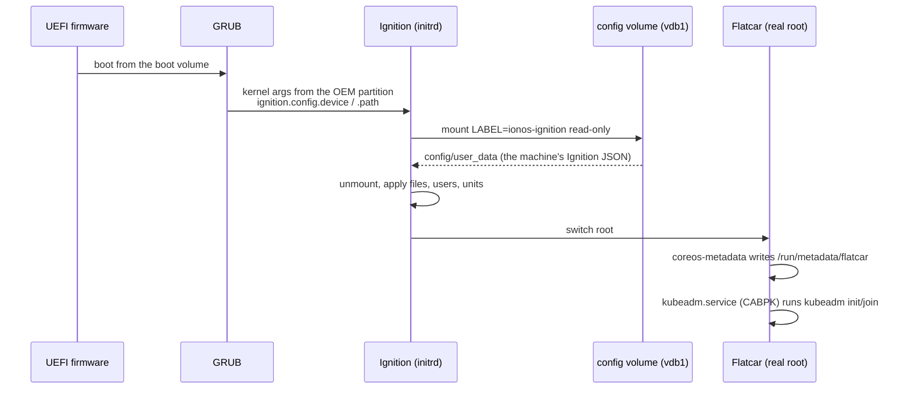
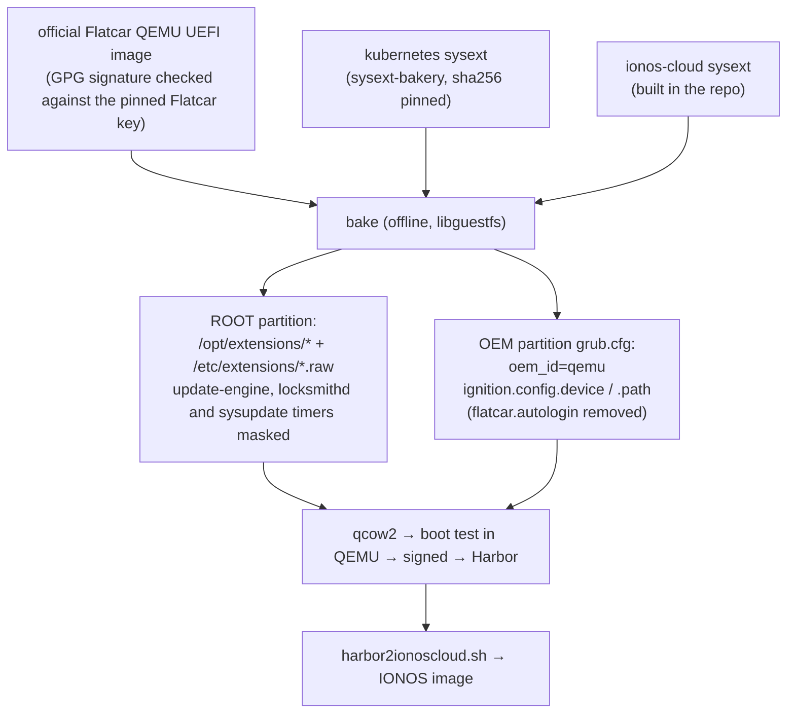

# Flatcar support on IONOS Cloud (design)

Status: proposal · Tracking issue: [#268](https://github.com/ionos-cloud/cluster-api-provider-ionoscloud/issues/268)

This document explains how we run [Flatcar Container Linux](https://www.flatcar.org/) nodes on IONOS
Cloud with CAPIC: how the image is built, how the machine's Ignition config reaches the VM, what we
tested, and what CAPIC has to change. Everything below was tried on real IONOS servers (`de/fra/1`,
October–November 2026) unless it says otherwise.

## The problem in one paragraph

Flatcar is configured on first boot by [Ignition](https://coreos.github.io/ignition/). Ignition needs
to find its config somewhere: a metadata service, a config drive, a kernel argument. IONOS Cloud has
no metadata service and no config drive. What it does have is a volume property called `userData`,
which today only works for cloud-init images. So the question was: how do we get the `userData` of a
volume into Ignition, without patching Flatcar?

## The short answer

1. IONOS already writes `userData` into a volume before the VM starts, if it finds a marker file on a
   partition of that volume.
2. Ignition (since 2.27) can read its config from a labelled partition, if two kernel arguments tell it
   where.
3. So we give every Flatcar machine a **second, tiny volume** that carries the marker, and we bake the
   two kernel arguments into the Flatcar image. IONOS writes the config onto the small volume, Ignition
   reads it from there. No fork of Flatcar or Ignition is needed.

```mermaid
flowchart LR
    CAPI["CAPI / CABPK<br/>bootstrap secret<br/>(format: ignition)"] -->|userData| CAPIC
    CAPIC -->|"create server<br/>vol 1: Flatcar image<br/>vol 2: config volume + userData"| API[IONOS Cloud API]
    API --> INJ["IONOS image handler<br/>(runs before first power-on)"]
    INJ -->|"finds USER_DATA_INJECTION_FLATCAR,<br/>writes config/user_data"| VOL2[("config volume<br/>label: ionos-ignition")]
    VOL2 -->|"ignition.config.device=ionos-ignition<br/>ignition.config.path=config/user_data"| IGN[Ignition in the initrd]
    IGN --> NODE[Flatcar node joins the cluster]
```



## How IONOS injects `userData`

When a volume is created with `userData`, the IONOS image handler runs
on the storage host **before** the VM is powered on.
It mounts each partition of the volume and looks around:

| What it finds on a partition | What it writes |
|---|---|
| `/etc/cloud/` (a cloud-init image) | `/var/lib/cloud/seed/nocloud/{user-data,meta-data}` |
| a file named `USER_DATA_INJECTION_FLATCAR` at the partition root | `<partition>/config/user_data` |
| neither | nothing |

Facts we checked:

- It looks at ext4/xfs-style data partitions only. Flatcar's own OEM (btrfs) and EFI (vfat)
  partitions are not used, and the stock Flatcar ROOT has no marker, so a plain Flatcar volume gets
  nothing.
- The file name is `config/user_data` (underscore). The API takes `userData` base64-encoded; the
  image handler decodes it and writes the result unchanged, so the file holds the plain Ignition JSON.
- It works on **any** volume of the server that has `userData`, not only the boot volume.
- The volume's image must have `cloudInit: V1`, otherwise IONOS rejects `userData`.
- Size is not a problem: a real CABPK control plane join config (with the CA keys) is 14.8 KB, 19.8 KB
  base64-encoded, about 9% more than the cloud-config we send today. IONOS accepted and wrote payloads
  up to 256 KB (350 KB base64) byte for byte.
- The risk is not the file mode inside the guest (Ignition mounts the volume for about a second). It is
  that the bootstrap data, which holds the CA keys on control plane nodes, sits on a volume that
  outlives the join. That is why CAPIC deletes the config volume (see below).

The marker-file path was added to the image handler for an earlier Flatcar attempt
([flatcar/scripts#2389](https://github.com/flatcar/scripts/pull/2389),
[coreos/ignition#1957](https://github.com/coreos/ignition/pull/1957)). Those upstream PRs were closed,
but the injector side stayed.

## How Ignition finds the config

[coreos/ignition#2230](https://github.com/coreos/ignition/pull/2230) (released in Ignition 2.27.0)
added two kernel arguments:

```text
ignition.config.device=ionos-ignition    # filesystem label to mount
ignition.config.path=config/user_data    # file to read on it
```

Ignition checks the kernel command line before any platform provider, so these two arguments are all
it takes. Flatcar ships Ignition 2.27.0 from **Flatcar 4820** on (Alpha/Beta at the time of writing;
Stable 4757 still has 2.24 and does not work).

Because the arguments are baked into the image, **the image cannot do its first boot without the
config volume**: Ignition waits 30 seconds for the `ionos-ignition` device and then fails the boot if
the device or `config/user_data` is missing. In CAPIC this shows up as a Machine that never gets a
`NodeRef`, so a MachineHealthCheck with `nodeStartupTimeout` should be used. Later boots never need the
volume, because Ignition only runs on the first boot.



The config volume is mounted for less than a second and never again, so it can be detached while the
node runs.

## How the Flatcar image is built

The image is built by the `flatcar-bake` pipeline in ionos-cloud/capi-image-builder
([PR #111](https://github.com/ionos-cloud/capi-image-builder/pull/111), an IONOS-internal repository),
in the folder `flatcar-bake/`, separate from the existing image-builder pipeline. It does not boot anything and does
not change Flatcar's read-only `/usr`.



What is in the image:

- **Kubernetes** as a [systemd-sysext](https://www.flatcar.org/docs/latest/provisioning/sysext/) from the
  [Flatcar sysext-bakery](https://github.com/flatcar/sysext-bakery) (same layout as the
  [CAPO](https://github.com/kubernetes-sigs/cluster-api-provider-openstack/tree/main/kustomize/flatcar-sysext)
  and CAPZ `flatcar-sysext` flavors). A generic image without Kubernetes can be built on request; the
  node then pulls the sysext at boot.
- **The `ionos-cloud` sysext**, which adds two small things:
  - a local metadata provider behind the standard `coreos-metadata.service` (IONOS has no metadata
    service, and [Afterburn](https://github.com/coreos/afterburn) has no IONOS provider);
  - `ionos-sysext-fetch.service`, which can pull sysexts from Harbor at boot.
- `oem_id=qemu`. The QEMU platform needs nothing from IONOS, and has no Afterburn step that expects a
  config drive.

The config volume (`ionos-ignition-config-volume`) is built by the same pipeline: a 1 GiB disk with one
ext4 partition labelled `ionos-ignition` that holds only the marker file. It contains no cluster data,
is reproducible, and is uploaded once per IONOS location.

### Image names and the image selector

CAPIC selects images by IONOS labels and, with `useMachineVersion: true` (the default), keeps only
images whose **name contains the Machine's version**. The pipeline names node images
`flatcar-<flatcar version>-ionos-kube-<kubernetes version>-<input hash>.qcow2`, for example
`flatcar-4820.1.1-ionos-kube-v1.37.1-2e11e69.qcow2`:

- The Kubernetes version in the name makes the default selector work.
- The input hash changes whenever anything that goes into the image changes, so a fixed image never
  overwrites a released one. Several builds of the same versions can exist side by side, so use
  `resolutionPolicy: Newest`.
- The match is a plain substring: `v1.37.1` also matches `v1.37.10`, and with `Newest` the wrong
  Kubernetes version could be picked. Until CAPIC matches the version with delimiters (step 8 below),
  keep one patch series per selector or add a version label to `matchLabels`.
- The generic image (Kubernetes pulled at boot) and the config volume image have no Kubernetes
  version in their names, so their selectors need `useMachineVersion: false`.

### Building the images yourself

The pipeline is internal, but nothing in it depends on IONOS internals. On Linux with
`libguestfs-tools`, `qemu-utils`, `gpg`, `fdisk` and `e2fsprogs`:

```sh
# Node image: official Flatcar QEMU UEFI image (>= 4820, Ignition >= 2.27), verified.
V=4820.1.1; K=v1.37.1
B=https://beta.release.flatcar-linux.net/amd64-usr/$V
curl -fLO $B/flatcar_production_qemu_uefi_image.img
curl -fLO $B/flatcar_production_qemu_uefi_image.img.sig
curl -fsSL https://www.flatcar.org/security/image-signing-key/Flatcar_Image_Signing_Key.asc | gpg --import
# Require a valid signature from the Flatcar Buildbot key itself, not just any key gpg knows.
gpg --status-fd 1 --verify flatcar_production_qemu_uefi_image.img.sig flatcar_production_qemu_uefi_image.img \
  | grep -q '^\[GNUPG:\] VALIDSIG .* F88CFEDEFF29A5B4D9523864E25D9AED0593B34A$' && echo "signature OK"

# Kubernetes sysext; compare with the SHA256SUMS of the sysext-bakery release.
curl -fLO https://extensions.flatcar.org/extensions/kubernetes-$K-x86-64.raw

cat > grub.cfg <<'EOF'
set oem_id="qemu"
set linux_append="ignition.config.device=ionos-ignition ignition.config.path=config/user_data"
EOF

# The image is already qcow2. Partition 9 is ROOT, partition 6 is OEM.
guestfish --rw --format=qcow2 -a flatcar_production_qemu_uefi_image.img <<EOF
run
mount /dev/sda9 /
mkdir-p /opt/extensions/kubernetes
upload kubernetes-$K-x86-64.raw /opt/extensions/kubernetes/kubernetes-$K-x86-64.raw
mkdir-p /etc/extensions
ln-sf /opt/extensions/kubernetes/kubernetes-$K-x86-64.raw /etc/extensions/kubernetes.raw
mkdir-p /etc/systemd/system
ln-sf /dev/null /etc/systemd/system/update-engine.service
ln-sf /dev/null /etc/systemd/system/locksmithd.service
ln-sf /dev/null /etc/systemd/system/systemd-sysupdate.timer
ln-sf /dev/null /etc/systemd/system/systemd-sysupdate-reboot.timer
umount /
mount /dev/sda6 /
upload grub.cfg /grub.cfg
EOF
mv flatcar_production_qemu_uefi_image.img flatcar-$V-ionos-kube-$K.qcow2

# Config volume: GPT disk, one ext4 partition labelled ionos-ignition, only the marker file.
truncate -s 1G cfg.raw
printf 'label: gpt\nstart=2048, type=0FC63DAF-8483-4772-8E79-3D69D8477DE4, name=ionos-ignition\n' | sfdisk cfg.raw
mkdir -p marker
printf '# DO NOT EDIT FILE\n# MANAGED BY IONOS CLOUD\n#\n# INDICATOR FILE FOR USER DATA INJECTION\n' \
  > marker/USER_DATA_INJECTION_FLATCAR
set -- $(sfdisk -l -o Start,Sectors cfg.raw | tail -n1)
truncate -s $(($2 * 512)) part.ext4
mkfs.ext4 -L ionos-ignition -d marker part.ext4
dd if=part.ext4 of=cfg.raw bs=512 seek=$1 conv=notrunc
qemu-img convert -O qcow2 cfg.raw ionos-ignition-config-volume.qcow2
```

Upload both to every location you use (FTP `ftp-<location>.ionos.com/hdd-images/`, or
`ionosctl image upload`), then set the image properties:

| Image | Required properties |
|---|---|
| Node image | `licenceType: LINUX`, `discVirtioHotPlug: true`, `nicHotPlug: true` |
| Config volume | `cloudInit: V1` (otherwise IONOS rejects `userData`), `discVirtioHotUnplug: true` (for the detach) |

Add the IONOS labels your image selectors match. This recipe does not include the `ionos-cloud`
sysext, so the `COREOS_IONOSCLOUD_*` metadata below is not available with it (see open points).

## Metadata for kubeadm templates

`coreos-metadata.service` writes `/run/metadata/flatcar`:

| Variable | Where it comes from | Verified value on IONOS |
|---|---|---|
| `COREOS_IONOSCLOUD_HOSTNAME` | DHCP host name (IONOS sends the server name) | the server name |
| `COREOS_IONOSCLOUD_INSTANCE_ID` | SMBIOS system UUID | the IONOS server ID |
| `COREOS_IONOSCLOUD_IPV4_PRIVATE` | first RFC 1918 or RFC 6598 (100.64/10) address | the private LAN NIC |
| `COREOS_IONOSCLOUD_IPV4_PUBLIC` | first other global address | the public LAN NIC |
| `COREOS_IONOSCLOUD_IPV4_DEFAULT` | source address of the default route | the public NIC |

This keeps the usual Flatcar CAPI template pattern working: `kubeadm.service` gets
`Requires=coreos-metadata.service`, `After=coreos-metadata.service` (so it waits until the file exists)
and `EnvironmentFile=/run/metadata/flatcar`, and `envsubst` fills
the kubeadm config. CAPIC names servers after their `IonosCloudMachine`, so the host name is the
machine name, which is what CAPI expects.

## What we tested

| Test | Result |
|---|---|
| Config volume injection | IONOS wrote `config/user_data` on the second volume, identical to what we sent (same sha256) |
| Ignition from the config volume | read in about 1 s, all stages applied |
| Metadata | all five variables matched the IONOS API exactly (server name, server ID, both NIC IPs) |
| CABPK-style kubeadm flow | `envsubst` rendered node name, `node-ip`, `provider-id: ionos://<server-id>` and cert SANs; `kubeadm init` ran on its own |
| Kubernetes v1.37.1 | node `Ready` with a CNI, InternalIP = private NIC, workload and Service working |
| Ignition spec 2.3 (what CABPK emits) | accepted: Flatcar's Ignition translates 2.x configs, all stages applied (QEMU boot of the baked image with the config on the config volume) |
| `userData` size | a real CABPK control plane join config (14.8 KB) and a 256 KB payload were both written byte for byte |
| Two NICs (public + private LAN) | works; the private LAN gives no default gateway, so routing stays on the public NIC |
| Detach the config volume while running | real hot-unplug, no reboot, no gap in a 1-second in-guest heartbeat, no external probe failures |
| Reboot after the detach | SSH back in 24 s, API ready in 38 s, Ignition did not run again, data and etcd intact |
| Image boot test in CI | every image boots in QEMU/OVMF with an injected config before it is pushed |

## Things we found the hard way

- **Set `bootOrder` on the volumes.** With two volumes, IONOS leaves the server's boot volume unset. The
  UEFI firmware then tries PXE and HTTP boot on every NIC before the disk: about 4.5 minutes per NIC
  on every boot. Creating the boot volume with `bootOrder: PRIMARY` and the config volume with
  `bootOrder: NONE` fixes it (SSH 13 s after the server was available, with two NICs). Setting it later
  also works, but makes IONOS restart the VM.
- **systemd ≥ 261 no longer writes DHCP lease files.** Flatcar Stable (systemd 260) still has them,
  Beta and Alpha (systemd 261) do not. The metadata provider reads the kernel host name, which
  networkd sets from DHCP.
- **Mask the `systemd-sysupdate` timers.** Flatcar 4820 enables `systemd-sysupdate-reboot.timer`; with
  no sysupdate transfer configured it fails once a day and leaves the node `degraded`. It only showed
  up after the test node had been running for a few days.
- **Do not convert the Flatcar QEMU images.** They are already qcow2; converting them as raw gives a disk
  with no partition table.

## What CAPIC needs to do

For a machine whose bootstrap secret has `format: ignition`:

1. Leave the bootstrap data untouched. Today CAPIC appends a cloud-init `bootcmd` to it, which breaks
   Ignition JSON. The host name already comes from DHCP. The JSON is only base64-encoded, as the API
   requires for `userData`.
2. Create the boot volume **without** `userData` and with `bootOrder: PRIMARY`. This is not only about
   boot time: `deleteServer` reads the server's boot volume, and if it is unset, deleting a single
   Machine calls `DeleteServer` with `deleteVolumes=false`, so the Flatcar boot volume would stay
   behind.
3. Add a second volume named `cfg-<machine name>` from the config volume image, with the bootstrap data
   as `userData` and `bootOrder: NONE`. The image comes from a new, optional field that reuses
   `ImageSpec` (an image ID or a label selector). The CRD default `useMachineVersion: true` applies
   here too, so a selector must set `useMachineVersion: false` (the config volume image name has no
   Kubernetes version). `lookupImageID` today always reads `spec.disk.image`, so it needs to take the
   `ImageSpec` as a parameter:

   ```go
   // BootstrapVolume is the volume that carries Ignition bootstrap data. Required when the
   // bootstrap data format is "ignition"; ignored for "cloud-config".
   // +optional
   BootstrapVolume *BootstrapVolume `json:"bootstrapVolume,omitempty"`

   type BootstrapVolume struct {
       Image            *ImageSpec       `json:"image"`
       DiskType         VolumeDiskType   `json:"diskType,omitempty"`
       AvailabilityZone AvailabilityZone `json:"availabilityZone,omitempty"`
   }
   ```

   The image needs `cloudInit: V1` and `discVirtioHotUnplug: true`. If the format is `ignition` and the
   field is not set, CAPIC sets a condition and emits an event instead of creating a server that can
   never boot.
4. After the node has joined (the Machine has a `NodeRef`), detach and delete the config volume.
5. Delete the config volume when the Machine is deleted, also if it never got a `NodeRef` (for example
   after a failed bootstrap). This needs explicit handling: when a single Machine is deleted, CAPIC
   only deletes the boot volume and keeps all other volumes for the CSI driver, so the config volume
   would otherwise stay behind, billed and holding bootstrap credentials.
6. Find the config volume by its fixed name, the way `getServer` finds the server by name today. A
   volume ID in the status is only a cache: if that status update is lost after the server was
   created, the volume is still found and cleaned up. CSI data volumes are never touched.
7. Add a Flatcar flavor to `templates/` and an e2e test for `format: ignition`, so the new path stays
   tested.
8. Match the Machine version in image names with delimiters (for example `-v1.37.1-` or a trailing
   `-`/`.`), so `v1.37.1` no longer matches `v1.37.10`. This affects all images, not only Flatcar.

`format: cloud-config` machines keep today's behaviour.

On the CAPI side, Ignition output must be enabled on the bootstrap provider with the
`KubeadmBootstrapFormatIgnition` feature gate (`EXP_KUBEADM_BOOTSTRAP_FORMAT_IGNITION=true`).

## Open points

- Flatcar 4820 is still Beta (4820.1.1 at the time of writing). We pin it until it reaches Stable.
- The `ionos-cloud` sysext (metadata provider and Harbor fetcher) lives in the internal pipeline, so
  users who build the image themselves don't get the `COREOS_IONOSCLOUD_*` variables. Two ways out,
  to be decided later:
  - **Open-source the sysext** in a separate public repository, so anyone can build or download it.
    It is small (two shell scripts and three systemd units) and has no IONOS-internal dependencies.
  - **Don't depend on it in the cluster template.** The template can compute the same values itself
    in `preKubeadmCommands`: the host name from `hostname`, the instance ID from
    `/sys/class/dmi/id/product_uuid`, and the node IP from the interface addresses. The image would
    then work with or without the sysext.
- The marker-file behaviour of the image handler is not documented publicly. We should agree with its
  owners that `USER_DATA_INJECTION_FLATCAR` → `config/user_data` is a stable contract.
- Not tested yet: `kubeadm join` of more nodes on IONOS (the join config size is verified, see above),
  hot-attach of CSI volumes, nodes with a private NIC only.
- `oem_id=qemu` is a stand-in. A real `ionoscloud` OEM in Flatcar
  ([flatcar/Flatcar#1570](https://github.com/flatcar/Flatcar/issues/1570)) would now be a two-line change.

## Links

- Image pipeline: [ionos-cloud/capi-image-builder#111](https://github.com/ionos-cloud/capi-image-builder/pull/111) (IONOS-internal)
- Ignition device/path kernel arguments: [coreos/ignition#2230](https://github.com/coreos/ignition/pull/2230)
- Flatcar sysexts: [flatcar/sysext-bakery](https://github.com/flatcar/sysext-bakery)
- Earlier attempt in CAPIC: [#270](https://github.com/ionos-cloud/cluster-api-provider-ionoscloud/pull/270)
- CAPI Ignition bootstrap: [Cluster API book](https://cluster-api.sigs.k8s.io/tasks/experimental-features/ignition)
